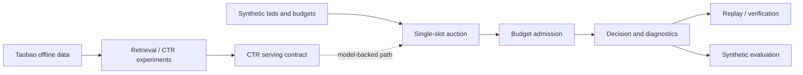

# SponsoredAdsDecisionLab

**How do retrieval, CTR estimates, auction pricing, and budget constraints combine into a reproducible sponsored-ad decision?**

SponsoredAdsDecisionLab is an offline advertising-systems and machine-learning portfolio project. It connects Taobao-derived retrieval and CTR experiments to a **simulated** single-slot auction, budget-aware decisions, deterministic replay, and auditable evaluation.

The guiding principle is:

> Separate observed-data modeling from simulated auction outcomes, make decisions reproducible, and report what the evidence does — and does not — establish.

## At a Glance

- **Release:** [`v1.0.0`](https://github.com/bagheri365/SponsoredAdsDecisionLab/tree/v1.0.0), commit `6b2f431`.
- **Core question:** how should CTR, bid, pricing policy, and budget availability affect a single sponsored-product decision?
- **Observed-data work:** Taobao-based retrieval, CTR baselines, calibration, and model-serving experiments.
- **Decision system:** deterministic single-slot ranking, two synthetic pricing policies, budget reservations, diagnostics, and replay.
- **Verification:** **388 tests passed**, with one known non-failing LightGBM feature-name warning, including a fresh-clone run.
- **M08 evaluation:** six fixed synthetic scenarios per policy; **3/6 filled**, with the same allocation under both policies.
- **Boundary:** these results do **not** measure online CTR, revenue, causal lift, or production performance.

Evidence: [M08-1 results](docs/experiments/M08-1-results.md) · [Architecture](docs/architecture.md) · [Five-minute demo](docs/portfolio-demo.md)

## Why This Project Exists

A sponsored-ad decision depends on several interacting mechanisms: candidate retrieval, relevance estimates, bids, auction pricing, and advertiser budgets. Testing them together without clear boundaries makes it hard to explain why an ad won, why a request went unfilled, or whether a replay matches the original decision.

This lab asks:

> Can we build a small, inspectable decision pipeline where each mechanism has a clear contract and its behavior can be independently tested?

The project is an engineering demonstration, not a claim that its synthetic auctions reproduce an advertising marketplace.

## Key Findings

### Deterministic allocation across pricing policies

The M08-1 harness evaluates the same six fixed scenarios with independent ledgers under two pricing policies. Both select the same winning ads and produce the same fill and no-fill outcomes.

| Synthetic evaluation metric | First-price | Score-second-price |
|---|---:|---:|
| Filled scenarios | 3 / 6 | 3 / 6 |
| Synthetic relevance-oracle agreement among fills | 2 / 3 | 2 / 3 |
| Mean winning ranking score | 0.30 | 0.30 |
| Reserved budget | 600 / 2,499 cents | 600 / 2,499 cents |
| Mean conditional CPC (synthetic units) | 2.00 | 0.83 |

The harness records one instance each of `no_candidates`, `no_eligible_or_above_reserve`, and `insufficient_budget` under each policy. Conditional CPC is a hypothetical click price, **not observed spend**. These are fixture outcomes, not marketplace estimates.

### Pricing changes the hypothetical payment, not the chosen winner

In these fixed cases, the allocation agrees across pricing policies while mean conditional CPC differs. This illustrates the separation between **ranking** and **pricing**; it does not establish that either policy performs better in a live auction.

### Replay and verification are part of the system design

M07 implements scored-decision replay, persisted-model integration, and offline artifact verification. M08 adds a deterministic report with stable input and report hashes. The goal is to make a decision explainable and repeatable, not just produce a winning ad ID.

### Reproducibility is checked independently of local data artifacts

The release was verified in a fresh Python 3.10 virtual environment: **388 tests passed**, the decision smoke test ran, and the M08 synthetic report reproduced the recorded hashes. The synthetic quick start does not require the Taobao CSV or a persisted CTR model.

## System Architecture



The diagram combines distinct experiment paths for orientation. **M08 uses fixed synthetic predicted CTRs; it does not load or score with the persisted CTR model.** See [architecture and engineering tradeoffs](docs/architecture.md) for exact boundaries.

## Evaluation Design

| Layer | What is evaluated | Evidence |
|---|---|---|
| Retrieval and CTR | Offline feature, retrieval, baseline, calibration, and serving experiments | [Dataset card](docs/data/taobao-ad-x1.md), [CTR baseline results](docs/experiments/M03B-ctr-baseline-results.md) |
| Auction ranking and pricing | Deterministic bid × predicted-CTR ranking; first-price and score-second-price rules | [Auction ranking ADR](docs/adr/ADR-M06A-001-deterministic-auction-ranking.md), [Pricing ADR](docs/adr/ADR-M06A-002-single-slot-pricing.md) |
| Budget-aware decision | Budget admission, reservations, and explicit no-fill reasons | [Budget ledger ADR](docs/adr/ADR-M06B-001-budget-ledger.md), [Budget admission ADR](docs/adr/ADR-M06B-002-budget-aware-admission.md) |
| Replay and artifacts | Scored replay, persisted-model replay, offline artifact verification | [M07B-4](docs/milestones/M07B-4.md) |
| Synthetic end-to-end cases | Six fixed scenarios, two policies, deterministic JSON and hashes | [M08-1 results](docs/experiments/M08-1-results.md) |

## Research and Engineering Evolution

| Phase | Main question | Outcome |
|---|---|---|
| M03–M05 | How do we develop and evaluate retrieval and CTR components? | Offline Taobao-based workflows, modeling and calibration contracts |
| M06A | How should one eligible ad be ranked and priced? | Deterministic auction and two pricing policies |
| M06B | How should budgets constrain allocation? | Ledger, admission logic, and synthetic budget experiments |
| M07A–M07B | Can model-backed decisions be replayed and verified? | Persisted-model smoke, replay diagnostics, and artifact verifier |
| M08-1 | Can fixed scenarios compare pricing policies reproducibly? | Six-scenario synthetic evaluation and recorded hashes |
| M09 / v1.0.0 | Can another engineer understand and run the project? | Architecture, demo, fresh-clone validation, and tagged release |

The [milestone history](docs/milestones/) and [experiment records](docs/experiments/) preserve the implementation and evaluation trail.

## Reproducibility

### Run locally (Python 3.10+)

```bash
python3.10 -m venv .venv
source .venv/bin/activate
python -m pip install -e '.[dev,ml]'
pytest -q
python -m sponsored_ads
python -m sponsored_ads.m08_synthetic_evaluation --output artifacts/m08/portfolio_demo.json
```

The final command **refuses to overwrite** an existing output file. Choose a new path when rerunning. For a guided walkthrough, use the [five-minute portfolio demo](docs/portfolio-demo.md).

### Recorded M08-1 artifact identity

| Artifact | SHA-256 |
|---|---|
| Canonical evaluation input | `a2db11807b5dbdf22b62bbc34c14b6159390054623d27c666ec3f41b48ab0446` |
| Canonical evaluation report | `896cf301d14b606d3e1e80b5696e43bd072adf6395441d2b1b07cd45d39fd54b` |

These hashes were reproduced in the fresh-clone release check. They describe the fixed synthetic evaluation, not the Taobao dataset or trained-model weights.

### Data prerequisites

The synthetic demo needs no external CSV. Taobao-dependent experiments require locally supplied data and their documented preparation steps; generated `artifacts/` are not committed. See [M03A](docs/milestones/M03A.md) and the [dataset card](docs/data/taobao-ad-x1.md). Source timestamps and point-in-time correctness remain unverified.

## Repository Structure

```text
SponsoredAdsDecisionLab/
├── src/sponsored_ads/   # retrieval, CTR, auction, budget, replay, evaluation
├── tests/               # regression and contract tests
├── docs/
│   ├── adr/             # auction, budget, and replay design decisions
│   ├── decisions/       # retrieval and CTR design decisions
│   ├── experiments/     # recorded evidence and limitations
│   └── milestones/      # implementation history
├── data/                # locally supplied data; see dataset card
├── artifacts/           # local generated reports, not release artifacts
├── pyproject.toml
└── README.md
```

## Design Tradeoffs

- **Determinism over distributed throughput:** the ledger and replay logic support inspectability, not production-scale concurrent reservation guarantees.
- **Explicit contracts over opaque end-to-end metrics:** ranking score, hypothetical CPC, and reserved budget are different quantities.
- **Small controlled fixtures over traffic realism:** six scenarios expose behavior and edge cases but cannot estimate real-world policy impact.
- **Separated ML and auction evidence:** observed-data CTR experiments and synthetic auction evaluation answer different questions.

## Limitations

- No live auction traffic, observed click charges, conversions, or causal lift measurement from the synthetic evaluation.
- No production serving SLOs, distributed concurrency guarantees, or implemented advertiser pacing system.
- No claim that the six synthetic scenarios represent real traffic or that synthetic oracle agreement predicts online relevance.
- No verified point-in-time correctness for source timestamps in the Taobao workflow.
- The persisted-model path is demonstrated separately; M08 does not perform model inference.
- One known non-failing scikit-learn/LightGBM feature-name warning remains in the regression suite.

## What This Project Demonstrates

A useful advertising decision system needs more than a CTR score or an auction formula. It needs **clear interfaces, budget-aware decisions, reproducible traces, and honest evaluation boundaries**. SponsoredAdsDecisionLab demonstrates those mechanisms in a deliberately small offline setting.

**Release:** [`v1.0.0`](https://github.com/bagheri365/SponsoredAdsDecisionLab/tree/v1.0.0) · **Documentation:** [Architecture](docs/architecture.md) · [Demo](docs/portfolio-demo.md) · [M08 results](docs/experiments/M08-1-results.md)
