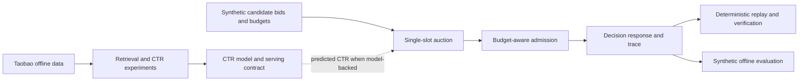

# Architecture and engineering tradeoffs

## System boundary

The diagram is conceptual, **not** a claim that the M08 evaluation invokes the
persisted CTR model. M08 supplies fixed synthetic predicted CTRs. Model-backed
integration is demonstrated separately by the M07A/M07B milestones.

## Main contracts

- `models.py` defines request/candidate types; candidate scores are supplied or
  produced upstream, not inferred by the auction itself.
- `auction_ranking.py` orders eligible candidates by `bid_cpc * predicted_ctr`
  with deterministic ad-ID tie-breaking.
- `auction_pricing.py` supports first-price and score-second-price policies.
  Conditional CPC is a hypothetical click price, not realized revenue.
- `budget_ledger.py` and `budget_admission.py` track and admit against available
  budget. The winning **bid** is reserved; reservation is not a click charge.
- `decision_service.py` returns a decision outcome and diagnostic trace, including
  explicit no-fill reasons.
- `decision_replay.py` and `m07b4_verify.py` support deterministic offline
  artifact inspection; `m08_synthetic_evaluation.py` runs fixed scenarios under
  independent policy/scenario ledgers.

## Tradeoffs worth discussing in an interview

| Choice | Benefit | Boundary / future extension |
| --- | --- | --- |
| Single-slot bid × CTR ranking | Transparent deterministic auction | No multi-slot externalities or sophisticated value optimization |
| Fixed synthetic evaluation scenarios | Reproducible edge-case coverage | Not representative traffic; add held-out sampled scenarios before estimating quality |
| In-memory budget ledger and reservations | Explicit state transitions and replay | No distributed atomicity, concurrency control, or pacing |
| Separate offline CTR and synthetic auction demonstrations | Clear observed-vs-simulated evidence boundary | No claim of calibrated online CTR or measured business impact |
| Canonical JSON and SHA-256 | Detects changes in serialized experiment artifacts | Hashes do not prove correctness, fairness, or causal effects |

## Suggested interview narrative

Explain the request/candidate contracts, the score-and-price distinction, the
budget reservation lifecycle, why replay and hashes help debugging, and why
fixed synthetic relevance agreement cannot be presented as online relevance.
A useful next design exercise is a sequence of requests sharing a ledger, then
concurrent reservations and pacing; neither is claimed as implemented by M08-1.
